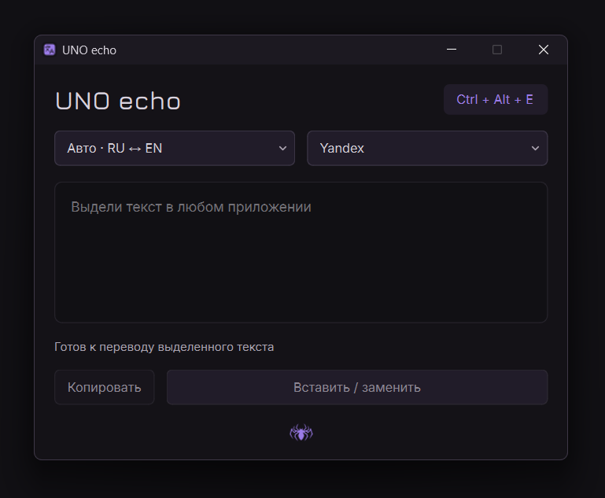

# UNO echo

Компактный переводчик **русский ↔ английский** для Windows.
Выделите текст, нажмите **Ctrl+Alt+E** — перевод появится в небольшом окне.

«Вставить / заменить» возвращает перевод в исходное поле ввода. Если исходный
текст остаётся выделенным, он заменяется переводом. Не меняйте выделение или
положение курсора в этом поле до вставки.

## Скачать и запустить

[**Скачать готовый ZIP для Windows x64**](https://github.com/Theo13-alt/uno-echo/releases/latest/download/UNO-echo-windows-x64.zip)

Распакуйте **весь архив** в отдельную папку и запустите `UNO echo.exe`.
Установка, Python и Qt не нужны. Выпуск проверен на Windows 11;
Windows 10 отдельно не проверялась.

## Как пользоваться

1. Выделите текст и нажмите **Ctrl+Alt+E**.
2. Скопируйте перевод или нажмите «Вставить / заменить».

В режиме «Авто · RU ↔ EN» направление переключается между русским и английским.
Направление и сервис перевода можно выбрать вручную.
Сворачивание убирает окно в трей, крестик завершает приложение.
Паучок внизу открывает сведения об авторах и лицензиях.

Для захвата и вставки исходная программа должна поддерживать **Ctrl+C / Ctrl+V**.
Буфер обмена после захвата восстанавливается. Если программа запущена от
администратора или сочетание занято, захват и вставка могут быть недоступны.

## Интернет

Для перевода нужен интернет. Текст отправляется выбранному сервису через Mozhi;
по умолчанию используется [mozhi.adminforge.de](https://mozhi.adminforge.de).
Адрес можно сменить: **паучок → «Сервер…»** или **меню трея → «Сервер перевода…»**.
Укажите адрес сайта Mozhi без `/api/translate`; он сохраняется для следующих запусков.
Текущий сервер виден в «О программе», кнопка «По умолчанию» возвращает исходный адрес.
Смена адреса не отправляет ему предыдущий текст. Доступность публичных серверов
не гарантируется, они могут ограничивать частоту запросов.

## Исходники и авторство

[Инструкция по сборке](BUILDING.md) — для тех, кто хочет собрать приложение сам.
Соответствующие исходники также включены в `source.zip` внутри готового пакета.

UNO echo создан на основе **Crow Translate** — это самостоятельная мини-версия.
Лицензия — [GPL-3.0-or-later](LICENSE). Авторы исходного кода и лицензии
компонентов перечислены в [CREDITS.md](CREDITS.md) и папке `licenses` готовой сборки.
